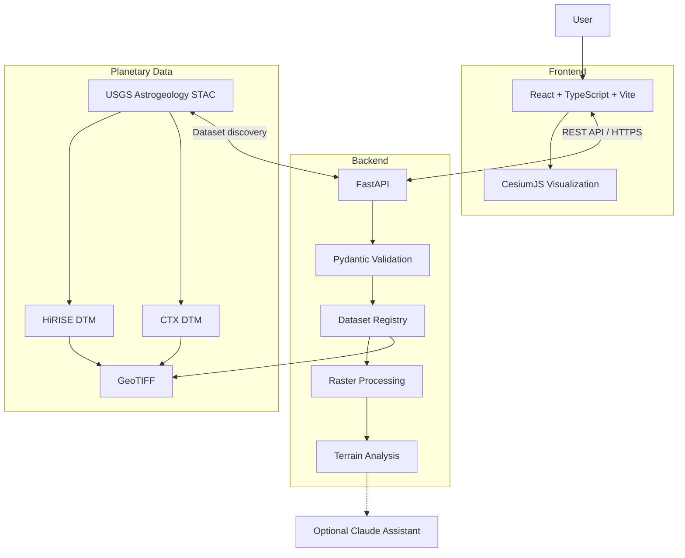

# MARSIGHT
### Interactive Mars Terrain Exploration Platform

**Explore Mars. Analyze its terrain. Understand its data.**

MARSIGHT is a planetary exploration platform that brings together interactive 3D visualization, Mars terrain dataset discovery, geospatial processing, and AI-assisted scientific interpretation.

It aims to make planetary elevation data more accessible through an integrated environment for discovering, exploring, and analyzing Mars Digital Terrain Models (DTMs).

---

## Overview

MARSIGHT connects planetary science data with modern web technologies to create an interactive Mars terrain exploration experience.

The platform combines:

- Interactive planetary visualization.
- Mars DTM dataset discovery.
- Geospatial raster processing.
- Scientific terrain analysis.
- Elevation statistics and profile generation.
- Optional AI-assisted interpretation of measured terrain data.

The underlying objective is to bridge the gap between complex planetary datasets and accessible scientific exploration.

## Core Capabilities

| Feature | Description |
|---|---|
| Planetary Visualization | Interactive 3D exploration using CesiumJS |
| Dataset Discovery | Mars terrain metadata discovery through USGS Astrogeology STAC |
| Raster Processing | GeoTIFF reading and processing using Rasterio and GDAL |
| Elevation Analysis | Minimum, maximum, mean, and standard deviation calculations |
| Terrain Analysis | Supported slope, aspect, and hillshade calculations |
| Elevation Profiles | Sampling elevation values along a selected profile |
| AI Research Assistant | Optional Claude-powered interpretation of measured terrain summaries |
| Scientific Validation | Raster metadata checks, NoData handling, and dataset provenance |

## Architecture

MARSIGHT follows a decoupled client-server architecture. The frontend handles visualization and user interaction, while the backend manages dataset discovery, raster validation, scientific processing, and optional AI integration.



## Technology Stack

| Category | Technologies |
|---|---|
| Frontend | React, TypeScript, Vite, JavaScript, CSS |
| 3D Visualization | CesiumJS |
| Backend | Python, FastAPI |
| Geospatial Processing | Rasterio, GDAL |
| Scientific Computing | NumPy |
| Data Validation | Pydantic |
| Dataset Discovery | USGS Astrogeology STAC |
| Planetary Data | HiRISE, CTX Digital Terrain Models |
| Data Format | GeoTIFF |
| AI Integration | Anthropic Python SDK, Claude |
| Deployment | Render Static Site, Render Web Service |

## Scientific Data Sources

MARSIGHT works with planetary terrain data infrastructure and Mars Digital Terrain Model collections.

| Source | Purpose |
|---|---|
| USGS Astrogeology STAC | Discovery of planetary datasets and metadata |
| HiRISE | High-resolution Mars terrain products |
| CTX | Additional Mars terrain products |
| GeoTIFF | Geospatial raster data format |
| Planetary Coordinate Reference Systems | Spatial referencing of Mars datasets |

### Dataset Integration Status

| Capability | Status |
|---|---|
| HiRISE collection discovery | Implemented |
| CTX collection discovery | Implemented |
| Approved HiRISE product registry | Implemented |
| HiRISE raster processing | Supported when the approved raster is configured |
| Local CTX GeoTIFF validation | Successfully tested on one dataset |
| CTX backend registration | Pending |

Dataset discovery does not automatically imply raster availability or processing support. Scientific processing is restricted to explicitly registered and validated products.

## Scientific Processing

The backend provides raster-based analysis for supported datasets.

### Elevation Statistics

For valid elevation measurements, the processing engine calculates:

| Measurement | Description |
|---|---|
| Minimum | Lowest valid elevation |
| Maximum | Highest valid elevation |
| Mean | Average valid elevation |
| Standard Deviation | Distribution of elevation values |
| Valid Pixels | Number of valid raster cells |
| NoData Pixels | Number of excluded raster cells |

### Terrain Derivatives

Where horizontal and vertical measurement units are compatible, the processing engine supports:

- Slope estimation using a Horn-style neighbourhood method.
- Aspect calculation.
- Hillshade generation.
- Elevation profile sampling.

### Processing Principles

- Validate raster metadata before analysis.
- Exclude NoData values from valid measurements.
- Process bounded raster windows.
- Preserve dataset provenance.
- Distinguish measured values from generated interpretations.

## AI-Assisted Terrain Interpretation

MARSIGHT includes an optional Claude-powered research assistant.

The AI integration is designed to interpret structured terrain measurements generated by the scientific backend.

| Component | Responsibility |
|---|---|
| Anthropic Python SDK | Provider integration |
| Claude | Contextual interpretation |
| FastAPI | Server-side request handling |
| Terrain Processing Engine | Source of measured terrain information |

AI-generated explanations are supplementary. They do not replace scientific calculations or independently verified measurements.

The AI integration is optional and does not replace the core processing pipeline.

## API Reference

The FastAPI backend exposes endpoints for health checks, dataset discovery, terrain analysis, and optional AI interpretation.

| Method | Endpoint | Description |
|---|---|---|
| GET | `/health` | Service health and configuration |
| GET | `/datasets` | Planetary dataset discovery |
| GET | `/api/v1/dtm/{item_id}/statistics` | Elevation statistics |
| GET | `/api/v1/dtm/{item_id}/window` | Terrain-window analysis |
| GET | `/api/v1/dtm/{item_id}/profile` | Elevation profile |
| POST | `/api/assistant/terrain-summary` | AI-assisted terrain interpretation |

Interactive API documentation is available through FastAPI's Swagger interface at `/docs`.

## Getting Started

### Prerequisites

- Git
- Node.js and npm
- Python 3.11 or a compatible version for the backend dependencies
- Required geospatial dependencies

### Clone the Repository

```bash
git clone https://github.com/lokeshLmp/MARSIGHT-Platform.git

cd MARSIGHT-Platform
```

### Frontend Setup

```bash
cd frontend

npm install

npm run dev
```

### Backend Setup

From the repository root:

```powershell
python -m venv .venv

.\.venv\Scripts\Activate.ps1

pip install -r backend/requirements.txt

uvicorn backend.main:app --reload
```

The backend development server runs at:

```text
http://127.0.0.1:8000
```

API documentation:

```text
http://127.0.0.1:8000/docs
```

**Configuration:** Scientific raster processing requires a correctly configured approved dataset. Optional Claude functionality requires the Anthropic SDK, backend-side credentials, and the appropriate environment configuration.

## Deployment

MARSIGHT uses independent frontend and backend deployments.

| Service | Platform | Responsibility |
|---|---|---|
| Frontend | Render Static Site | React production application |
| Backend | Render Web Service | FastAPI and scientific processing |

The two services communicate through HTTPS-based REST API requests.

Environment variables are used for API configuration, CORS settings, raster locations, and optional AI credentials.

**Security:** API keys and private credentials must remain in backend environment configuration and must never be committed to Git.

## Testing

Previously recorded development test results:

| Test Suite | Result |
|---|---|
| Backend | 48 passed, 1 skipped |
| Frontend | 7 passed |
| Production frontend build | Passed |

The skipped backend test requires an actual raster dataset. These results represent recorded development tests, not complete end-to-end verification of every live dataset or optional service.

## Project Status

MARSIGHT is under active development.

- [x] React and TypeScript frontend
- [x] CesiumJS visualization layer
- [x] FastAPI backend
- [x] USGS planetary dataset discovery
- [x] HiRISE approved-product processing infrastructure
- [x] Raster statistics and terrain analysis
- [x] Elevation profile functionality
- [x] Optional Claude assistant endpoint
- [x] Frontend and backend deployment
- [ ] CTX backend registration and processing
- [ ] Complete live end-to-end AI verification

## Scientific Limitations

MARSIGHT is an exploratory scientific platform. Its results depend on source-data quality, raster coverage, coordinate systems, measurement units, and processing assumptions.

- Discovered metadata does not guarantee raster accessibility.
- Only registered and validated raster products are accepted for current scientific processing.
- CTX processing is not yet integrated into the backend.
- Terrain derivatives require compatible horizontal and vertical units.
- Elevation-profile distances depend on the raster coordinate reference system.
- AI interpretations are not independent scientific measurements.
- The platform does not establish rover traversability, landing-site safety, or mission survival predictions.

Scientific traceability and responsible interpretation are fundamental to the project.

## Future Development

- Expand supported Mars DTM products.
- Complete CTX raster integration.
- Improve planetary coordinate transformation support.
- Extend terrain comparison and visualization capabilities.
- Improve scientific provenance and reproducibility.
- Complete live verification of AI-assisted terrain interpretation.

## References

- [USGS Astrogeology](https://astrogeology.usgs.gov/)
- [HiRISE](https://www.uahirise.org/)
- [CesiumJS](https://cesium.com/platform/cesiumjs/)
- [React](https://react.dev/)
- [TypeScript](https://www.typescriptlang.org/)
- [FastAPI](https://fastapi.tiangolo.com/)
- [Rasterio](https://rasterio.readthedocs.io/)
- [GDAL](https://gdal.org/)
- [NumPy](https://numpy.org/)
- [Anthropic Documentation](https://docs.anthropic.com/)

---

<p align="center">
  <strong>MARSIGHT</strong>
  <br>
  Advancing planetary exploration through data, science, and technology.
</p>
